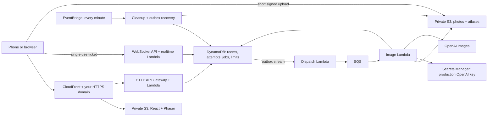

# Catch Me If You Can on AWS

The owner requested full AWS shutdown on 2026-10-14, superseding the earlier deployment authorization. The public game at `catchmeifyoucan.space` is offline. Do not bootstrap or redeploy unless the owner explicitly requests it. The architecture and deployment instructions below are retained for reference; the previous backend region was `ap-south-1`.

## Shutdown status, 14 October 2026

The five application Lambda functions were first restricted to zero concurrency and the cleanup schedule disabled. CloudFormation deletion then removed the functions. The retained DynamoDB table, production key, website bucket and private image bucket were explicitly deleted, including every website object version. Production image accounting was archived locally before database deletion: 23 settled requests, no unsettled reservations, and 1,553,181 microdollars ($1.553181) used against the $15 lifetime ceiling. The archive is in ignored `artifacts/aws-shutdown-2026-10-14/production-image-spend.json`; no credentials or player photos were exported. The local development ledger was not modified.

Read-only checks across all 17 enabled AWS regions found no EC2 instances, Auto Scaling groups, ECS clusters, EC2 fleets, Spot fleets, or active/open Spot instance requests. The deployment region also has no EventBridge rules, Scheduler schedules, or CodePipeline pipelines. GitHub CI only tests with fixture providers and has no AWS deployment credentials.

Both `CatchMeIfYouCan` and `CDKToolkit` reached `DELETE_COMPLETE`. The retained CDK asset bucket was then explicitly deleted. Final service inventories confirmed no S3 buckets, Lambda functions/layers/event mappings, HTTP or WebSocket APIs, DynamoDB tables/backups, SQS queues, Secrets Manager secrets, CloudWatch log groups/alarms/dashboards, ECR repositories, or app/CDK IAM roles remained in the deployment scope. The CloudFront distribution and its dedicated ACM certificate in `us-east-1` were deleted. The former HTTPS URL no longer completes a TLS handshake. No app resources remain running or configured to restart.

The AWS account has no Route 53 hosted zones or registered domains. External DNS and domain registration are outside this AWS teardown.

A future deployment must restore the recorded production spending before enabling image generation; deleting infrastructure does not renew the $15 lifetime allowance. New installations default to images off and budget zero. The unchanged development allowance is $1.

## Understand the pieces



CloudFront serves the game and sends `/api/*` to Lambda. Owner cookies pass only to the API, which checks them before reading artwork or changing state. An origin secret prevents direct API Gateway requests from forging the viewer address used for creation limits. The real game URL is the configured custom domain.

DynamoDB holds durable state. Movement has a separate item per player; catches transact with scores and notices. Instances can restart without losing rooms. New rooms use WebSockets for gameplay, with short-lived single-use tickets issued by the HTTP API. The dedicated realtime Lambda has no image library layer, S3 access or provider secret; it handles movement, shared catches and connection fanout. Old independent rooms retain HTTP polling.

Photos upload directly to private S3 using a five-minute, size-limited policy, avoiding Lambda’s request payload limit. The worker verifies the digest/ETag and normalizes the photo. Job and room reads authorize the cookie before signing a GET lasting at most 60 seconds. S3 CORS allows only the game origin.

A transaction saves each queued image-job revision and outbox together. The stream dispatcher sends it to SQS; scheduled recovery retries failed dispatches. Duplicate deliveries cannot claim a revision twice. Provider output is saved before atlas composition so interrupted work can recover the same image. Unknown outcomes pause for explicit retry and retain their spending reservation.

## Build without an AWS account

Use Node 24+, npm and Docker. These checks create only temporary local resources and make no OpenAI calls:

```bash
npm ci
npm test
npm run build:aws
npm run test:production
npm run test:infra
npm run infra:synth
npm run test:lambda
npm run test:aws
npm run test:load:aws
npm run test:load:shared
npm run security:check
```

`build:aws` writes the frontend to `apps/web/dist`, Lambda bundles to `artifacts/aws/functions`, and a Linux x86_64 Sharp layer to `artifacts/aws/layer`. Only those explicit directories become deployment assets. `.env`, uploaded photos, SQLite files and the development ledger are excluded. The runtime check loads all three bundles and processes an image inside the official Lambda Node 24 container.

`infra:synth` writes a reviewable CloudFormation template to `artifacts/cdk.out`, without deploying. Infrastructure tests check private buckets, isolated secrets, image generation disabled by default, TTL, throttles, queues and routes. DynamoDB tests reject non-loopback endpoints and use dummy credentials.

## Connect the deployment account

Use AWS CLI v2.32 or newer. Sign in through the browser with a named profile:

```bash
aws login --profile catch-me-if-you-can --region ap-south-1
aws sts get-caller-identity --profile catch-me-if-you-can
```

Complete authentication in the AWS browser window. Keep credentials out of chat, project files and shell commands. Verify the returned account before creating resources. For an IAM user or role, AWS requires `SignInLocalDevelopmentAccess` for this login method; IAM Identity Center users should use `aws configure sso --profile catch-me-if-you-can` instead. See [AWS browser-based CLI sign-in](https://docs.aws.amazon.com/cli/latest/userguide/cli-configure-sign-in.html).

Use the same profile for all account commands and CDK operations. If a login expires, sign in again; don't replace it with access keys in the repository.

## Domain and certificate

Choose the exact hostname, such as `play.example.com`. DNS can stay at its current provider; moving the whole domain to Route 53 is unnecessary.

Request an ACM certificate covering the hostname in **us-east-1**, add ACM’s DNS validation CNAME at the provider, and wait for issuance. CloudFront requires its viewer certificate in that region even when the backend runs elsewhere. See [AWS certificate requirements](https://docs.aws.amazon.com/AmazonCloudFront/latest/DeveloperGuide/cnames-and-https-requirements.html).

The stack defaults to backend region `ap-south-1`. Set `CDK_DEFAULT_REGION` to choose another. No account or DNS lookup is needed for synthesis: `DomainName` and `CertificateArn` are deployment parameters.

## Check the regional Lambda quota

Before the first deployment, inspect the account's available concurrency:

```bash
aws lambda get-account-settings \
  --profile catch-me-if-you-can --region ap-south-1 \
  --query AccountLimit --output json --no-cli-pager
```

New accounts can start with only 10 concurrent executions. For an initial sample-artwork deployment, explicitly select `ConcurrencyMode=shared`. It omits function reservations and uses the account's existing shared pool, so a quota increase is not a prerequisite. API Gateway allows 60 requests/second with a burst of 10; SQS still limits image-job processing to two concurrent invocations. Keep `ImageEnabled=false` and `ImageBudgetMicros=0` for the first deployment. All functions compete for the shared pool, so cold starts, cleanup and other applications can cause throttling. Verify five concurrent players through the real domain before wider sharing; local tests do not prove AWS capacity.

`ConcurrencyMode=reserved` preserves the original per-function caps: 20 API, two image workers and one cleanup. It remains the parameter default so an existing deployment's caps cannot disappear implicitly. [Lambda requires another 100 to remain unreserved](https://docs.aws.amazon.com/lambda/latest/dg/configuration-concurrency.html), so at least 123 unreserved executions must be available before a first deployment in reserved mode. A switch from shared to reserved mode requires sufficient capacity too. Other applications' reservations also consume the account's quota.

To increase capacity later, request **AWS Lambda → Concurrent executions** in Service Quotas in the deployment region. Although 200 is sufficient for this stack in an otherwise unused account, the request API can reject values below the AWS default of 1,000 even when the applied account limit is only 10. If it reports that the requested value must exceed 1,000, request 1,001 or contact AWS Support about restoring the standard quota. Wait for the applied limit to increase before selecting reserved mode; a submitted request alone does not change it. Approval does not automatically change the stack's mode or enable image generation. After approval, redeploy with `ConcurrencyMode=reserved` to isolate function capacity.

## Deployment

1. Connect the intended account as above and configure hosting billing alerts. The image allowance caps OpenAI generation, not AWS hosting charges.
2. Build and review the template. Review `npx cdk diff CatchMeIfYouCan --profile catch-me-if-you-can --method template` in that account. Bootstrap the account/region if this is its first CDK deployment; bootstrap itself creates resources. Use `npx cdk bootstrap aws://ACCOUNT_ID/ap-south-1 --profile catch-me-if-you-can`, replacing `ACCOUNT_ID` with the verified account number.
3. Deploy sample mode with the actual hostname and issued certificate ARN:

   ```bash
   npx cdk deploy CatchMeIfYouCan \
     --profile catch-me-if-you-can \
     --parameters DomainName=play.example.com \
     --parameters CertificateArn=YOUR_ISSUED_US_EAST_1_CERTIFICATE_ARN \
     --parameters ConcurrencyMode=shared \
     --parameters ImageEnabled=false \
     --parameters ImageBudgetMicros=0 \
     --outputs-file artifacts/aws-outputs.json
   ```

4. Point the subdomain’s CNAME to the `CloudFrontDomain` output. A root/apex domain needs the DNS provider’s supported ALIAS/ANAME flattening or a Route 53 alias. Keep ACM’s validation record for renewal.
5. Open `GameUrl` using HTTPS. Refresh a direct `/r/<id>` invite and `/create?from=<id>`. Real app routes return HTML; API errors and missing assets keep their proper responses.
6. Complete the live smoke checks below before wider sharing. AWS latency, IAM behavior, DNS and CloudFront deployment cannot be proven by local synthesis.

## Updating this existing deployment

Build with `npm run build:aws`, then review `npx cdk diff CatchMeIfYouCan --profile catch-me-if-you-can --region ap-south-1 --method template`. The expected additions include the WebSocket API/stage/routes, realtime Lambda and connection IAM permissions, plus its exact endpoint in the browser CSP. Preserve the existing domain, certificate and budgets. After deployment, verify `RealtimeUrl`, create a new invite (old invites keep their old protocol), and run the five-phone checks below. No DNS record is required for the AWS WebSocket endpoint.

## Enable personal photos separately

The OpenAI secret initially contains a disabled placeholder. Only the image worker can read it. In Secrets Manager, replace it with the **raw fresh production key** using the console’s plaintext editor. Keep keys out of commands, Git, frontend variables and screenshots. The development key and ledger stay local.

After a production budget is explicitly approved, update `ImageBudgetMicros` and `ImageEnabled=true`. One dollar is 1,000,000 microdollars. This is a **lifetime ceiling**, not a daily allowance. Increasing the parameter raises that ceiling; rooms, days, restarts and deployments never reset usage. Each call reserves $0.20 under the pinned request profile. Missing usage, connection failures and interrupted calls retain the reservation. Six successful calls normally make a father pack. A player portrait makes one laughing face and shares this same allowance; it never starts a six-expression job.

Never delete `IMAGE_BUDGET` or `IMAGE_SPEND#...` items to unblock generation. Financial records have no TTL; the table has retention/deletion protection. Production budget changes do not authorize further development spending. `.father-hunter/development-spend.sqlite` remains capped at $1 and must not be reset or moved.

Invalid access/quota responses pause generation for five minutes and preserve faces without an automatic retry loop. A changed key or restored quota can be retried after cooldown. Temporary failures receive only bounded retries, respecting short Retry-After values. Sample games, existing rooms and retained artwork reuse keep working when generation is unavailable.

## Verify through the real domain

- Using sample artwork (no paid generation), share one named sample room, join from five independent browsers and reject a sixth seat. Check secure HTTP-only cookies and the canonical invite hostname.
- Join the same shared lobby from five browsers. Ready everyone, start from the host, verify one countdown and visible movement. Race for the same father: exactly one score must increase. Check mobile practice, one-tap navigation, desktop board, mobile results, reconnect, refresh, host transfer and rematches.
- Create a game from each participant’s results. Verify distinct links, empty boards and fresh hour windows. Use a controlled test fixture for closure and the additional 24-hour results/artwork boundary.
- Confirm strangers cannot read private jobs, photos or room atlases. Direct S3 reads and direct gateway calls must fail. API failures must not become HTML.
- In a fixture-only test deployment, verify upload CORS, signed-image redirects, SQS duplicate delivery, outbox recovery and cleanup before a separately approved real likeness test.

The two opt-in live checks create disposable sample rooms and spend no image allowance:

```bash
node scripts/live-shared-browser-check.mjs https://catchmeifyoucan.space
node scripts/shared-load-check.mjs --live-url https://catchmeifyoucan.space
```

The first uses five independent Chromium contexts, including mobile layouts, through an actual two-minute round. The second sustains five moving/catching WebSockets for three minutes over the deployed gateway and DynamoDB. On 11 October 2026 the live load check passed 4,401 responses with zero failed commands and 198 ms peer p95 across two rounds. Both save results in ignored `artifacts/`. They do not replace a physical-phone friend playtest.

## Limits, monitoring and recovery

Shared mode starts at 60 API requests/second, burst 10, using the account's available concurrency. Reserved mode allows 100 requests/second, burst 200, with a cap of 20 concurrent HTTP Lambdas. Shared movement sends up to five WebSocket batches per second; idle connections heartbeat every two seconds. Legacy rooms additionally poll twice per second; actions can flush sooner. The WebSocket stage allows 500 requests/second with a burst of 250: five players at five inputs/second produce up to 125 outgoing deliveries/second, in addition to incoming messages. A lower callback limit caused live 429 errors during the first sustained test. These are starting limits, not unlimited public capacity; adjust after measuring the deployed service. Gateway throttles are best-effort targets, not spending caps. Creation limits are atomic across instances. Photo creation also has a global 20-job/day limit. The image queue processes at most two invocations concurrently in either mode. The 300-second worker uses a 1,800-second queue visibility timeout, following [AWS SQS guidance](https://docs.aws.amazon.com/lambda/latest/dg/services-sqs-configure.html).

The browser predicts up to one second of unconfirmed walking. The server accepts the same bounded backlog using elapsed server time and still validates each collision step, sequence, catch and deadline. Face visibility allows one second of delivery delay; that allowance never extends the round timer or catch distance. Five-browser tests inject 350 ms command latency as well as throttling and lost receipts. If players report slow walking, check rendering and round-trip latency alongside Lambda duration and throttles; increasing Lambda capacity alone cannot repair a client that stalls while awaiting acknowledgements.

CloudWatch has a dashboard and alarms for API failures/throttles, realtime delivery failures, image failures/backlog, dead letters and cleanup failures. Handled callback errors are counted from redacted structured logs because they do not increment Lambda’s error metric. Transient callback failures preserve the player’s session; only a Gone response removes the connection. Logs retain seven days without request bodies, cookies or raw provider errors. No email or external notification subscription is created automatically.

Cleanup runs each minute. Access deadlines are enforced on requests; [DynamoDB TTL is asynchronous physical deletion](https://docs.aws.amazon.com/amazondynamodb/latest/developerguide/TTL.html). Player source photos are removed after processing and player faces expire with the one-hour room; father source photos are removed at finalization and unfinished father jobs expire after 24 hours and incomplete direct uploads after 15 minutes. Room art lasts through the one-hour game plus 24-hour results window. S3’s three-day lifecycle bounds orphan retention during failures.

For an image outage, set `ImageEnabled=false` and preserve the ledger. Check secret configuration, queue age and redacted job status. A dead-letter delivery is not permission to generate again: revisions and saved state control that. Do not reset uncertain reservations without reconciling provider charges.

For a regression, rebuild and redeploy the last passing commit. Keep database changes backward-compatible. Website files are versioned, old assets are preserved, and `index.html` deploys last with no-store plus invalidation. Wiping the table or private images is not a rollback step.

`cdk destroy` removes compute/edge resources but retains the state table, image key and buckets. Full shutdown needs an explicit retention/export/deletion decision, removal of DNS records and review of retained resources for continuing charges.
